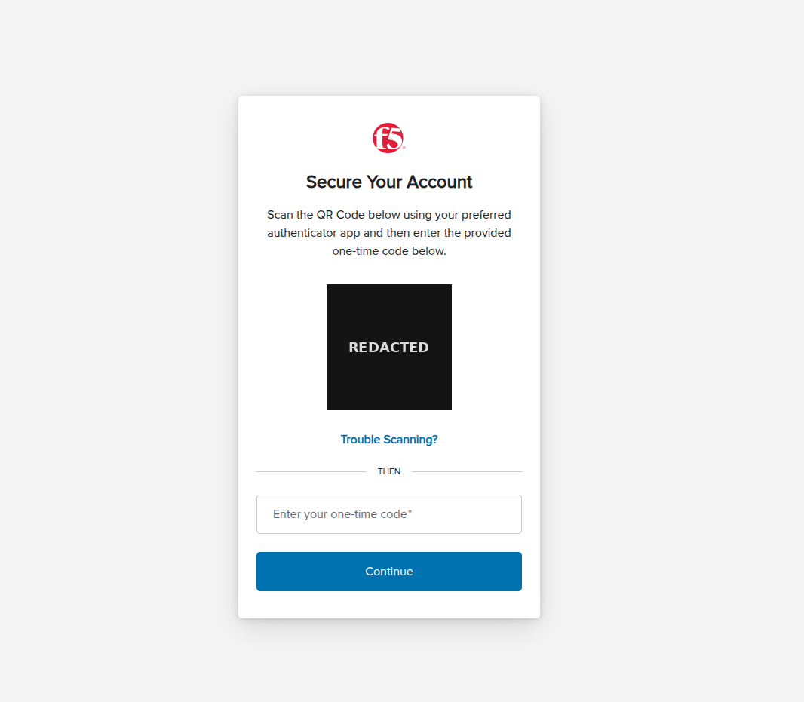
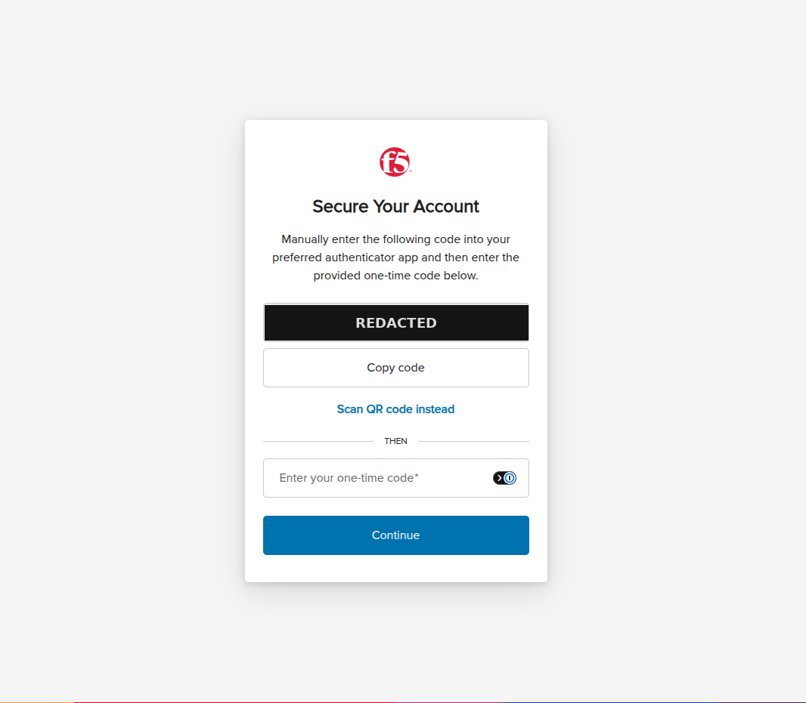
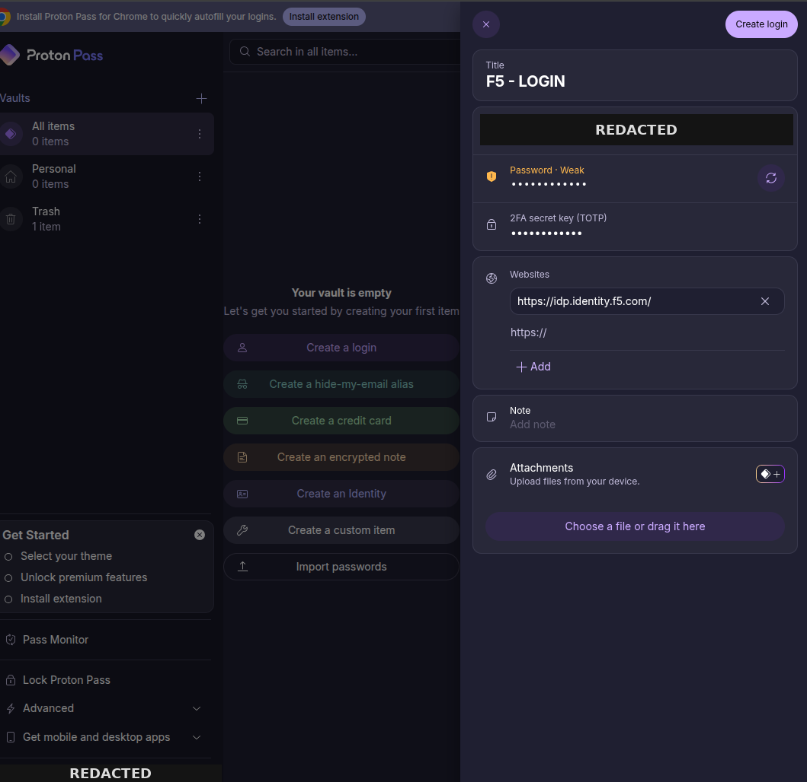
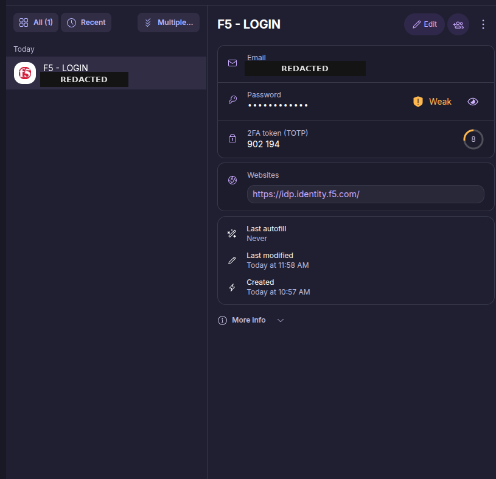
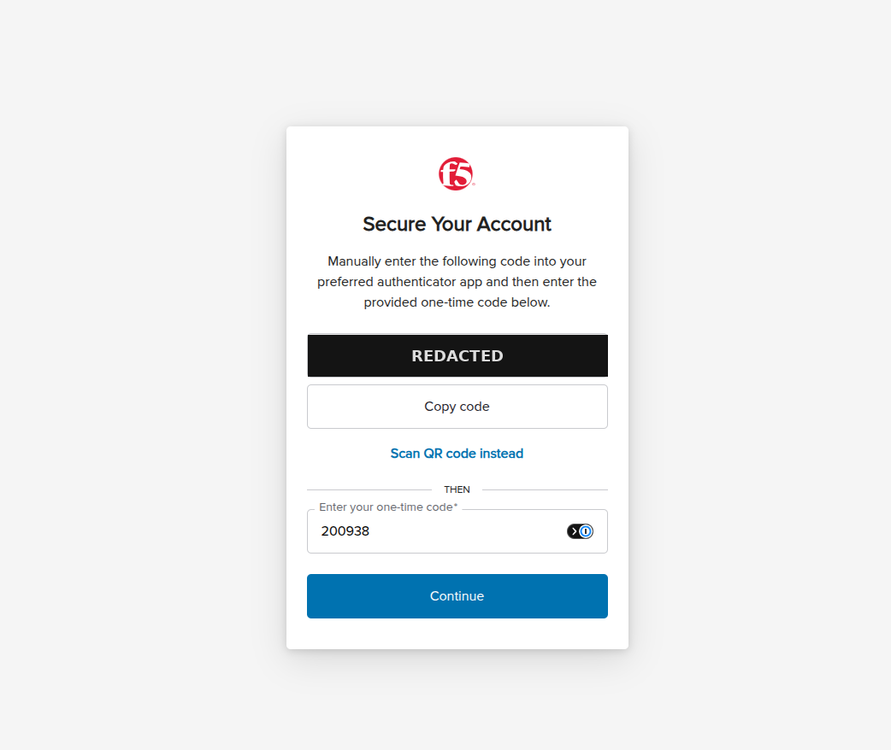
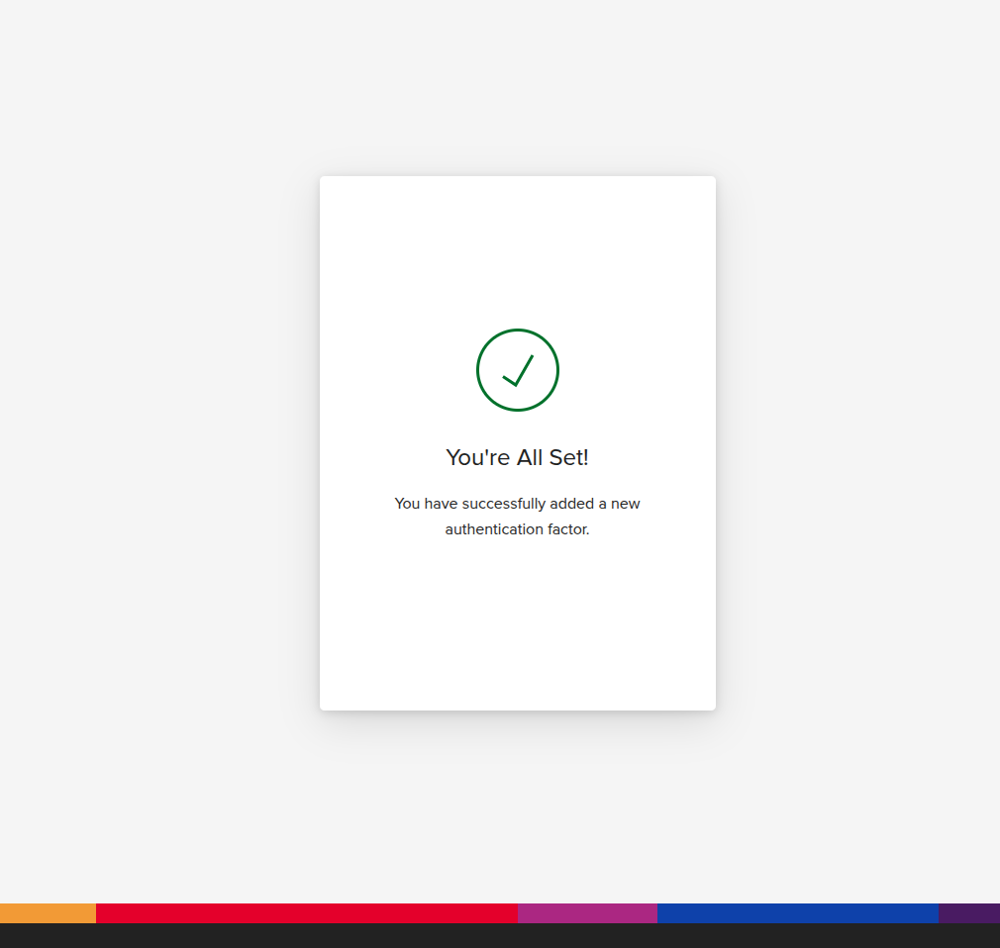

# Setting Up TOTP Multi-Factor Authentication for Your F5 (MyF5) Account

> **Using Proton Pass (or any RFC 6238 TOTP authenticator)**

| Metadata | Details |
|:---|:---|
| **Audience** | F5 customers with MyF5 / `account.f5.com` accounts |
| **Reference** | F5 Knowledge Article K000162308 |
| **Applies to** | MyF5 login via `idp.identity.f5.com` (Auth0) |
| **Time required** | Approximately 10 minutes |

---

## 1. Background

F5 has migrated its customer identity platform from Okta to Auth0 (`idp.identity.f5.com`). As part of this change, **email-based MFA is no longer permitted**. At your next login, you will be prompted to enroll a non-email MFA factor before proceeding.

Any standards-based TOTP (RFC 6238) authenticator satisfies this requirement. This guide uses **Proton Pass** because it is free and runs entirely in a web browser—requiring no mobile device, which is particularly useful in environments where personal phones are restricted.

The same workflow applies to any standard authenticator:

* **Mobile apps:** Google Authenticator, Microsoft Authenticator, Authy
* **Password managers with TOTP support:** 1Password, Bitwarden, KeePassXC
* **Hardware tokens:** Physical tokens supporting RFC 6238 TOTP provisioning

> [!NOTE]
> TOTP codes are generated locally from a shared secret and the current time. No network connection to F5 is needed to generate a code—only an accurate system clock.

### Web-based alternatives to Proton Pass

If your organization already standardizes on an enterprise password manager, or Proton services are restricted in your environment, any of the tools below operate without a mobile device. The configuration procedure is identical across all tools: paste the Base32 secret into the tool's TOTP field, then read the rotating 6-digit code.

| Option | Type | Cost | Notes |
|:---|:---|:---|:---|
| **Proton Pass** | Web vault + browser extension | Free tier includes TOTP | Used in this guide |
| **Bitwarden** | Web vault + browser extension | TOTP requires Premium tier | Widely used in enterprises; self-hosting available |
| **Ente Auth** | Web app + desktop app | Free | Open source; dedicated authenticator (not a password manager) |
| **KeePassXC** | Offline desktop app | Free | Open source; no cloud dependency—suits restricted/air-gapped environments |
| **1Password** | Browser extension + desktop | Paid | Common corporate standard |
| **Authenticator.cc** | Browser extension | Free | Lightweight; extension only |

> [!IMPORTANT]
> Pricing and tier features change over time; verify against each vendor's documentation before selecting an organizational standard.

---

## 2. What You'll Need

* An active MyF5 account ([account.f5.com](https://account.f5.com) / [my.f5.com](https://my.f5.com))
* A Proton account (the free tier is sufficient)
* A modern web browser with access to both MyF5 and Proton Pass (two tabs or side-by-side windows recommended)
* Approximately 10 minutes

---

## 3. Part A — Set Up Proton Pass (First-Time Users)

*Skip this section if you already use Proton Pass or another TOTP-capable authenticator.*

1. Navigate to [https://proton.me/pass](https://proton.me/pass) and click **Create a free account**.
2. Choose a username and a strong master password. This master password protects your vault—**do not reuse your MyF5 password**.
3. Complete any required verification (e.g., CAPTCHA or email confirmation).
4. Once signed in, you will be directed to the Proton Pass web vault.
   * *(Optional)* Install the browser extension via the banner at the top to enable auto-fill; the web vault alone is completely sufficient for this setup.

> [!TIP]
> Record your Proton account recovery phrase and recovery email immediately. If you lose access to your Proton account, you will lose the stored F5 TOTP secret and cannot generate login codes.

---

## 4. Part B — Retrieve the TOTP Secret from F5

1. In a separate tab, sign in to [my.f5.com](https://my.f5.com) using your email address and password.
2. After entering your password, the **Secure Your Account** enrollment screen appears displaying a QR code.
3. The QR code is intended for mobile scanning. Since Proton Pass is web-based, click **Trouble Scanning?** directly below the QR code.
4. The screen will switch to manual-entry view and display a **Base32 secret key** (a string of alphanumeric characters). Click **Copy code**.
5. **Keep this browser tab open.** You will return here in [Part D](#6-part-d--verify-enrollment-with-f5) to enter your initial one-time verification code. Do not click *Continue* yet.

| Figure 1: QR Code View | Figure 2: Manual Entry View |
|:---:|:---:|
|  |  |
| *Figure 1 — Enrollment prompt. The QR code encodes the secret.* | *Figure 2 — Manual-entry view with Base32 secret key.* |

> [!CAUTION]
> The Base32 secret is a sensitive credential, not a single-use token. Anyone possessing this key or a capture of the QR code can generate valid MFA tokens indefinitely. Never email it, paste it into public channels, or store it unencrypted.

---

## 5. Part C — Create the Login Entry in Proton Pass

1. Switch back to your Proton Pass tab and click **Create a login**.
2. Fill out the entry details:
   * **Title:** Enter a recognizable name (e.g., `F5 - LOGIN`).
   * **Email or username:** Enter your MyF5 login email.
   * **Password:** Enter your MyF5 account password *(optional, but recommended to enable full autofill)*.
   * **2FA secret key (TOTP):** Paste the Base32 secret string copied from Part B, Step 4. Ensure there are no leading or trailing whitespace characters.
   * **Websites:** Add `https://idp.identity.f5.com/` (the Auth0 identity provider URL). You can also add `https://my.f5.com/`.
3. Click **Create login**.
4. Open the newly saved entry. A **6-digit rotating code** and an animated countdown ring should now appear in the 2FA field, updating every 30 seconds.
   * *Note:* If the raw text string appears instead of a rotating 6-digit code, the secret was entered into a notes field rather than the dedicated 2FA TOTP field. Edit the entry and re-paste into **2FA secret key (TOTP)**.

| Figure 3: Entry Form | Figure 4: Active TOTP Generator |
|:---:|:---:|
|  |  |
| *Figure 3 — Completed entry with URL and secret key.* | *Figure 4 — Active 6-digit code with 30s countdown timer.* |

---

## 6. Part D — Verify Enrollment with F5

1. In Proton Pass, click the current 6-digit code to copy it to your clipboard.
   * *Check the countdown timer:* If fewer than 5 seconds remain, wait for the next 30-second window before copying.
2. Return to the F5 **Secure Your Account** browser tab and paste the code into the **Enter your one-time code** field.
3. Click **Continue**.
4. F5 will display the **You're All Set!** confirmation screen. The TOTP factor is now successfully bound to your account.
5. Log out and perform a complete sign-in to verify the login flow: Password $
ightarrow$ One-time MFA code $
ightarrow$ Access granted.

| Figure 5: Verification Code Entry | Figure 6: Enrollment Confirmation |
|:---:|:---:|
|  |  |
| *Figure 5 — Pasting the one-time code into F5.* | *Figure 6 — Final enrollment confirmation.* |

---

## 7. Logging In After Enrollment

1. Browse to [my.f5.com](https://my.f5.com) and supply your credentials as usual.
2. When prompted for your one-time authentication code, open your Proton Pass web vault or browser extension.
3. Copy the current 6-digit code from your `F5 - LOGIN` entry (or let the extension auto-fill).
4. Paste the code and submit. Codes expire every 30 seconds; always use the currently active code.

---

## 8. Security Best Practices

* **Back up the Base32 secret securely:** The secret key cannot be re-read from F5 after completing enrollment. Store a copy in an encrypted, offline backup. If you lose your authenticator and have no backup, an F5 support case is required to reset MFA.
* **Evaluate vault consolidation risk:** Combining your password and TOTP secret in the same vault entry offers convenience, but merges two factors into a single security boundary. For higher-security requirements, store the TOTP secret in an independent authenticator application or device.
* **Verify clock synchronization:** TOTP validity depends strictly on accurate client time. Verify that devices generating codes synchronize their clocks via Network Time Protocol (NTP).
* **Treat enrollment captures as credentials:** Redact or securely delete screenshots containing the QR code or Base32 manual entry string.

---

## 9. Troubleshooting

| Symptom | Likely Cause | Recommended Action |
|:---|:---|:---|
| **Code rejected during entry** | Expired code or device clock skew | Wait for the next 30-second code cycle and retry. If issues persist, verify system time synchronization (NTP). |
| **Raw text displayed instead of 6-digit code** | Secret pasted into standard text field | Edit the entry in Proton Pass and move the secret into the **2FA secret key (TOTP)** field. |
| **Code rejected repeatedly despite synced clock** | Whitespace or character truncation | Return to F5, copy the Base32 key again, and ensure no leading/trailing spaces exist when pasting. |
| **No MFA prompt on login** | Enrollment was abandoned before verification | Log in and finish the **Secure Your Account** workflow end-to-end. |
| **Lost authenticator / locked out** | Authenticator lost without backup key | Submit an F5 Support request to reset the account's MFA factors. |
| **Autofill does not prompt on login** | Missing domain match | Ensure `https://idp.identity.f5.com/` is specified under the entry's **Websites** field and the browser extension is active. |

---

## 10. Support

If you experience account lockout or require an MFA factor reset, reach out through the following channels:

* **F5 Support Portal:** [https://my.f5.com](https://my.f5.com)
* **Official Migration Notice:** F5 Knowledge Base Article **K000162308**
* **Account Representative:** Contact your designated F5 account team
